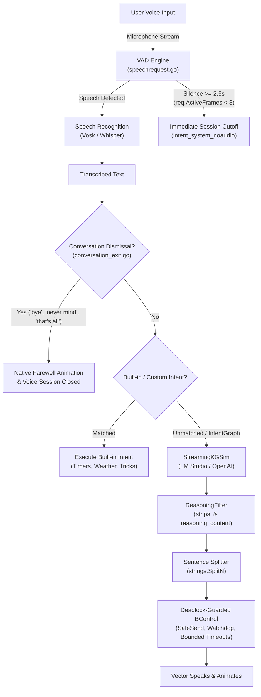

# wire-pod

`wire-pod` is fully-featured, open-source server software for the Anki / Digital Dream Labs **Vector** robot (Vector 1.0 and 2.0). It acts as a 100% self-hosted replacement for defunct cloud servers, enabling voice commands, local speech recognition, animations, custom intents, and local LLM integrations with zero subscription fees.

---

## Key Features

- **Local Speech-to-Text (STT)**: Built-in Vosk (default, supports 14 languages) and Whisper.cpp for offline, low-latency voice transcription.
- **Local & Cloud LLM Integrations**:
  - Direct support for **LM Studio**, **Ollama**, **vLLM**, **llama.cpp**, and OpenAI-compatible endpoints.
  - **Sentence-by-Sentence Streaming**: Vector starts speaking the first sentence immediately while subsequent sentences stream in the background.
  - **Reasoning Model Filter**: Automatically strips `<think>...</think>` tags and filters `reasoning_content` (DeepSeek, Qwen 2.5, Muse-Glimmer, etc.) so internal reasoning is never spoken aloud.
  - **Robot Actions & Vision**: The LLM can trigger physical animations (`{{playAnimationWI||happy}}`), snap photos from Vector's camera (`{{getImage||front}}`), and conduct multi-turn back-and-forth conversations.
- **Deadlock-Guarded gRPC Concurrency**:
  - Non-blocking channel primitives (`SafeSendBool`, `SafeSendString`) and bounded timeouts across all robot behavior control pipelines.
  - Automated runtime `Watchdog` that captures goroutine stack traces if any gRPC call misses its deadline.
- **Smart Conversational Exit & Silence VAD**:
  - 2.5-second pure silence cutoff prevents Vector from getting stuck in an endless "listening" state when you stop talking.
  - Fast conversation dismissal engine recognizes *"that's all"*, *"never mind"*, *"goodbye"*, *"i'm good"*, and *"stop"*, cleanly concluding voice sessions with native animations without unnecessary LLM roundtrips.
- **Windows + Docker Desktop One-Command Setup**:
  - Automated Bonjour mDNS proxy (`dns-sd.exe`) bridges `escapepod.local` across Docker's NAT to your physical Wi-Fi/LAN.

---

## Architecture & Concurrency Hardening

Recent updates have significantly improved reliability, streaming responsiveness, and concurrency safety:



### 1. Deadlock Prevention & Concurrency Guarding
- **Safe Channel Dispatch**: Located in [`chipper/pkg/wirepod/ttr/deadlock_guard.go`](./chipper/pkg/wirepod/ttr/deadlock_guard.go). Replaces unbounded blocking sends (`ch <- val`) with non-blocking `select` semantics and bounded waits (`WaitBoolWithTimeout`), preventing goroutine hangs if a stream terminates unexpectedly.
- **Runtime Watchdog**: Operation watchdog triggers automated runtime goroutine stack traces when an asynchronous gRPC operation exceeds its configured deadline, facilitating instant diagnosis.
- **Behavior Control Overhaul**: [`bcontrol.go`](./chipper/pkg/wirepod/ttr/bcontrol.go) ensures `start` notification channels are always dispatched even upon network failures or gRPC dropouts, eliminating stuck callers.

### 2. Stuck "Listening" Fixes & VAD Silence Threshold
- **VAD Silence Detection**: In [`speechrequest.go`](./chipper/pkg/wirepod/speechrequest/speechrequest.go), the voice activity detector previously required initial active frames before checking inactivity. If a user stayed silent during conversational turns, Vector listened for the full 30 seconds. A pure-silence threshold of 2.5 seconds now terminates voice sessions cleanly.
- **Conversation Dismissal Detection**: Fast regex parsing in [`conversation_exit.go`](./chipper/pkg/wirepod/ttr/conversation_exit.go) intercepts conversational exits (*"goodbye"*, *"bye"*, *"never mind"*, *"that's all"*, *"i'm good"*, *"no thanks"*, *"cancel"*, *"stop"*), immediately ending the dialogue with native Vector confirmation rather than prompting the LLM.
- **AudioFeed Cleanup**: Eliminated continuous background `AudioFeed` streams in [`watcher.go`](./chipper/pkg/wirepod/ttr/watcher.go) that were locking Vector's onboard mic pipeline.

---

## Quick Start (Windows + Docker Desktop)

On Windows, Docker Desktop operates in an isolated NAT network. Use the included PowerShell startup script to launch wire-pod, detect your host LAN IP, and advertise `escapepod.local` over mDNS via Windows Bonjour:

```powershell
# 1. Start wire-pod and run the Bonjour mDNS proxy:
.\start-windows-docker.ps1

# 2. To rebuild the container after making Go code changes in chipper/:
.\start-windows-docker.ps1 -Build
```

Once running:
1. Open the Web Dashboard: **`http://localhost:8080`** (or `http://<your-lan-ip>:8080`).
2. Vector connects to port `443` and `8084` at `escapepod.local`.
3. To monitor logs live:
   ```powershell
   # Fetch debug logs via API:
   (Invoke-WebRequest -Uri 'http://localhost:8080/api/get_debug_logs' -UseBasicParsing).Content
   ```

---

## Connecting a Local LLM (LM Studio / Ollama)

1. Open **LM Studio** and start the local server on port `1234` (enable **Serve on Local Network**).
2. Load any model (e.g. `meta/muse-glimmer`, `qwen2.5`, `llama-3.2`).
3. In wire-pod's Web UI (**Server Settings** -> **Knowledge Graph**):
   - **Provider**: `Custom`
   - **API Key**: `lm-studio`
   - **Endpoint**: `http://host.docker.internal:1234/v1` (inside Docker) or `http://localhost:1234/v1` (native)
   - **Model**: `<model-id>`
   - Enable **Intent-Graph**, **Commands**, and **Save Chat**.

---

## Running the Unit Tests

All concurrency, deadlock prevention, and conversation dismissal logic are covered by automated unit tests:

```bash
# Run tests inside Docker or native Go environment:
go test -v ./pkg/wirepod/ttr/...

# Run with Go's race detector enabled:
go test -v -race ./pkg/wirepod/ttr/...
```

Test coverage includes:
- `TestDeadlockGuard_SafeSend`: Confirms non-blocking safety on full and unbuffered channels.
- `TestDeadlockGuard_WaitTimeouts`: Verifies clean timeout exits and context cancellations.
- `TestDeadlockGuard_Watchdog`: Validates runtime stack capture upon missed deadlines.
- `TestDeadlock_BControlFailure_UnblocksCaller`: Verifies network/gRPC connection failures immediately unblock waiting callers.
- `TestDeadlock_ConcurrentChannelStress`: 100 concurrent workers stressed under `-race`.
- `TestIsConversationDismissal`: Verifies regex matches for all conversational dismissals and farewells.
- `TestReasoningFilter`: Tests stripping `<think>...</think>` tags and reasoning blocks across streaming chunks.

---

## Detailed Guides & Onboarding

For comprehensive instructions on:
- How `wire-pod` works under the hood
- Step-by-step firmware flashing and pairing via Web Bluetooth
- Firewall and VPN troubleshooting
- Custom Lua scripting and onboard audio playback

👉 See the complete **[Onboarding & Developer Guide (ONBOARDING.md)](./ONBOARDING.md)**.

---

## Credits

- [Digital Dream Labs](https://github.com/digital-dream-labs) for open-sourcing chipper and creating escape pod.
- [kercre123](https://github.com/kercre123) for creating wire-pod.
- [fforchino](https://github.com/fforchino) for the vector-go-sdk and localization extensions.
- All contributors across the Vector community.
